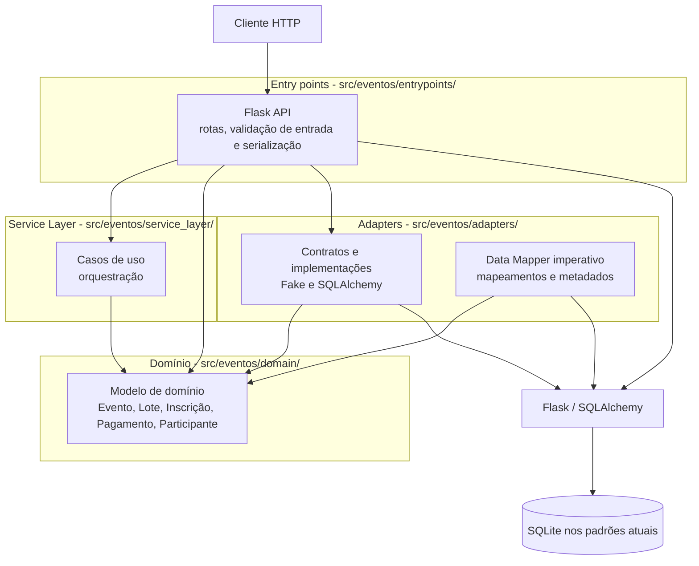

## Escopo

O sistema é uma plataforma para gestão completa de eventos, englobando a criação e organização de eventos, controle de estoque de lotes de ingressos, inscrições de participantes, processamento de pagamentos e verificação de check-in no dia do evento. Ele atende a dois perfis principais de usuários:

1. **Organizadores:** responsáveis pela criação e gestão dos eventos e pela definição dos lotes de ingressos (preços e quantidades).
2. **Participantes:** usuários que se inscrevem em lotes disponíveis, realizam o pagamento e efetuam o check-in na entrada do evento.

A arquitetura do sistema foi projetada para garantir a integridade das regras de negócio (como limitação de vagas por lote, validação cadastral de participantes e bloqueio de check-in para inscrições pendentes), assegurando que as invariantes de domínio permaneçam isoladas dos detalhes de infraestrutura (banco de dados SQLite e API HTTP em Flask).

# Arquitetura do sistema

## Visão geral

O sistema é uma aplicação Python organizada em camadas, com separação inspirada em **Ports & Adapters (Arquitetura Hexagonal)**. O domínio concentra entidades e regras de negócio; a camada de serviço coordena casos de uso; adapters implementam persistência; e o entrypoint Flask expõe a API HTTP. A separação é parcial: a API instancia adapters concretos e controla transações, portanto a infraestrutura ainda atravessa a fronteira de entrada.

As setas indicam dependência/uso: o consumidor aponta para o componente de que depende. O banco SQLite em memória é criado por `create_app()` quando nenhuma sessão é fornecida; os testes também usam SQLite em memória. O diagrama representa a implementação atual, não uma arquitetura alvo.

## Componentes e responsabilidades

| Componente | Mapeamento | Responsabilidade e evidências |
|---|---|---|
| Entry point HTTP | `src/eventos/entrypoints/` | `flask_app.py` define rotas, converte JSON, serializa entidades, mapeia erros HTTP, cria os repositórios SQLAlchemy e chama `session.commit()`. |
| Camada de aplicação | `src/eventos/service_layer/` | `services.py` implementa casos de uso como criar/encerrar evento, confirmar inscrição e registrar/aprovar pagamento. Coordena repositórios e operações do domínio. |
| Modelo de domínio | `src/eventos/domain/` | `model.py` define entidades, enums e invariantes: transições de estado de Evento, Inscrição e Pagamento, validação de Participante e controle de estoque no Lote. |
| Adapters e persistência | `src/eventos/adapters/` | `repository.py` contém contratos abstratos e implementações Fake e SQLAlchemy. `orm.py` define tabelas e mapeia imperativamente as classes de domínio com SQLAlchemy. |
| Testes | `tests/unit/`, `tests/integration/`, `tests/e2e/` | Testam regras de domínio, repositórios com SQLite e a API via cliente Flask. Fakes permitem testes sem banco em parte da suíte. |

## Estilos e padrões

- **Arquitetura em camadas:** entrypoint, serviço, domínio e persistência têm responsabilidades reconhecíveis. O fluxo normal é HTTP → serviço → domínio/repositório → persistência.
- **Ports & Adapters, de forma incompleta:** contratos abstratos de repositório e fakes dão ao serviço uma fronteira substituível para persistência. Porém, os contratos estão no pacote `adapters`, não no domínio/aplicação, e o Flask escolhe diretamente implementações SQLAlchemy. Assim, o entrypoint conhece detalhes de infraestrutura.
- **Repository:** interfaces abstratas descrevem operações de armazenamento, com implementações fake e SQLAlchemy para Evento, Inscrição e Pagamento. Há também um contrato e implementação SQLAlchemy para Lote, mas não um Fake de Lote.
- **Service Layer:** funções de serviço coordenam entidades e repositórios sem colocar a lógica das rotas dentro do modelo. Exemplo: `confirmar_inscricao_apos_pagamento` verifica o pagamento e atualiza a inscrição.
- **Data Mapper clássico:** `orm.py` associa tabelas a classes existentes com `map_imperatively`, em vez de fazer as entidades herdarem de classes ORM. Isso reduz o acoplamento direto do modelo ao SQLAlchemy, embora o adapter dependa do modelo.
- **Regras no domínio:** transições e invariantes locais são métodos das entidades, como `Inscricao.realizar_checkin()` e `Pagamento.estornar()`. Regras que atravessam entidades são coordenadas pelos serviços.

## Fluxo de uma requisição

1. Uma rota Flask interpreta a requisição e chama a função de serviço correspondente.
2. O serviço consulta ou altera entidades por meio dos repositórios e invoca operações de domínio.
3. O repositório SQLAlchemy opera sobre a sessão compartilhada com a aplicação.
4. A rota confirma a sessão e serializa o resultado em JSON.

Nos testes, o cliente Flask recebe uma sessão SQLite em memória, o que permite percorrer o fluxo HTTP sem um serviço de banco externo. Os testes unitários também usam repositórios fake em alguns casos.

## Limitações observadas

- **Fronteira de transação no entrypoint:** as rotas fazem `commit()` diretamente, de modo que o serviço não é dono da transação e depende de coordenação do Flask. Isso diverge da intenção registrada de deixar o controle transacional na camada de serviço.
- **Contratos de repositório incompletos/inconsistentes:** `encerrar_evento` requer `listar_por_evento`, mas esse método não está no contrato nem na implementação SQLAlchemy de Inscrição. O endpoint detecta a ausência e responde `501`; `tests/e2e/test_eventos_api.py` documenta esse comportamento.
- **Composição de Evento e Lote não é uniforme:** o mapeamento ORM associa lotes ao evento, mas o serviço chamado pela rota de criação não associa o lote ao Evento nem chama o repositório de Lote para persistência. Além disso, o serializador da rota acessa `lote.evento_id`, atributo que `LoteDeIngresso` não define. O estoque do lote também não é atualizado pelo fluxo de criação de inscrição.
- **Associação da inscrição ao lote simplificada:** a tabela de inscrições persiste `lote` como texto, não como referência à tabela `lotes`. Isso limita integridade referencial e operações conjuntas sobre vaga, inscrição e pagamento.
- **Dependências de infraestrutura expostas:** `repository.py` importa SQLAlchemy para definir as implementações concretas; o entrypoint instancia essas classes e também cria engine/sessão. A inversão de dependência existe em parte, não de ponta a ponta.
- **Escopo ainda monolítico e síncrono:** Flask, serviço, domínio e persistência rodam no mesmo processo. Eventos de domínio, mensageria e CQRS aparecem na proposta da Fase 2, mas não estão implementados na estrutura atual.

## Avaliação

A escolha por camadas, entidades com invariantes e repositórios é adequada para o porte atual e facilita testes focados. A evidência não sustenta, porém, que o sistema já esteja plenamente hexagonal ou pronto para crescer como um fluxo transacional consistente: o entrypoint seleciona infraestrutura, o commit está nas rotas e contratos entre agregados estão incompletos. A prioridade arquitetural mais valiosa é completar os contratos de persistência necessários aos casos de uso e tornar explícita a fronteira transacional; introduzir mensageria ou CQRS antes disso aumentaria o custo sem resolver as lacunas atuais.

## Referências no código

- `src/eventos/domain/model.py`
- `src/eventos/service_layer/services.py`
- `src/eventos/adapters/repository.py`
- `src/eventos/adapters/orm.py`
- `src/eventos/entrypoints/flask_app.py`
- `tests/e2e/test_eventos_api.py`
- `DECISIONS.md`
- `PROPOSTA.md`