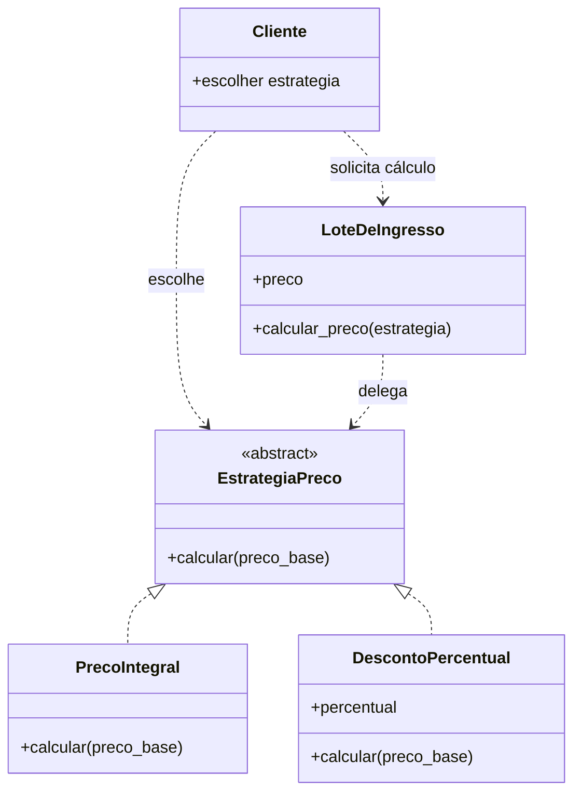
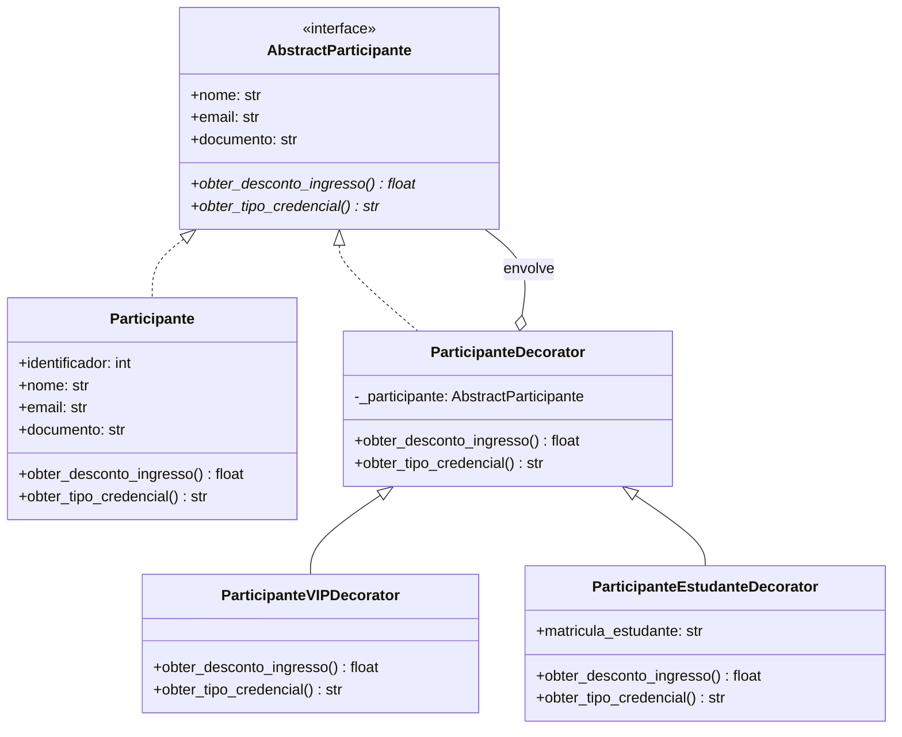

# Padrão GoF: Strategy

- **Categoria:** comportamental.
- **Agregado:** `LoteDeIngresso`.

## Contexto e problema

O lote mantém o preço-base do ingresso (`preco`), mas regras diferentes podem
ser necessárias para calcular o valor cobrado, como preço integral ou desconto
percentual. Concentrar todas essas variações em condicionais de
`LoteDeIngresso` faria a entidade conhecer cada política e exigiria alterá-la
sempre que uma nova regra fosse adicionada.

O método `LoteDeIngresso.calcular_preco` delega o cálculo a uma estratégia
fornecida pelo chamador. `PrecoIntegral` mantém o preço-base, enquanto
`DescontoPercentual` calcula o valor com desconto. O preço persistido continua
sendo o preço-base; a política é selecionada para cada cálculo.

## Por que Strategy

Strategy permite variar o algoritmo sem acoplar o lote às regras concretas e
sem alterar o comportamento existente de criação, venda ou persistência do
lote. Uma alternativa seria colocar uma condição para cada tipo de promoção
dentro de `LoteDeIngresso`; essa opção parece mais simples inicialmente, mas
faz a entidade acumular regras e crescer a cada nova política. State também
foi considerado, mas não se ajusta ao problema: o cálculo depende de uma
política escolhida, não de uma transição do ciclo de vida do lote.

## Participantes

| Papel no padrão | Classe/método no sistema |
|---|---|
| Contexto | `LoteDeIngresso`, que mantém o preço-base e delega em `calcular_preco` |
| Strategy | `EstrategiaPreco`, contrato abstrato com `calcular` |
| Concrete Strategy | `PrecoIntegral`, que retorna o preço-base |
| Concrete Strategy | `DescontoPercentual`, que aplica o percentual validado |
| Cliente | Chamador de `LoteDeIngresso.calcular_preco`, que escolhe a estratégia |

## Diagrama de classes

## Teste

`tests/unit/test_ingresso.py::teste_lote_calcula_preco_com_estrategias_diferentes`
exercita as duas estratégias no mesmo lote: preço integral e desconto de 25%.
`teste_desconto_percentual_invalido` também verifica a validação do intervalo
permitido para o desconto.

## Custo da aplicação

Nesta implementação, o custo inicial foi criar uma
interface (`EstrategiaPreco`), duas implementações (`PrecoIntegral` e
`DescontoPercentual`) e o método de delegação em `LoteDeIngresso`, além dos
testes. Cada nova política de preço exige outra classe de estratégia e testes próprios. 
O chamador também precisa escolher e fornecer a estratégia quando calcula o preço.

Entretanto, há mais arquivos conceituais e indireção do que com um
cálculo simples ou uma condição dentro do lote. Para apenas duas regras
estáveis, essa estrutura pode ser desnecessária; seu benefício aparece quando
as políticas variam ou novas regras são adicionadas com frequência. Nesse caso,
a regra nova fica isolada e não aumenta os condicionais nem altera
`LoteDeIngresso`. As estratégias não precisam ser persistidas, então não há
custo de migração do esquema do banco de dados.

# Padrão GoF: Decorator

- **Categoria:** Estrutural
- **Agregado:** `Inscrição` (`Participante`)
- **Autora:** Gabriela Bitencourt Freire da Silva (@gabibitencourt)

## Contexto e problema

O sistema precisava conceder benefícios e tratamentos diferenciados (como descontos no valor do ingresso e identificação em credenciais/crachás) para categorias especiais de participantes (ex: VIP, Meia-Entrada / Estudante).

Adicionar múltiplos campos booleanos (`is_vip`, `is_estudante`) na classe `Participante` violaria o Princípio da Responsabilidade Única (SRP) e inflaria a entidade. Por outro lado, criar subclasses estáticas para cada combinação possível geraria uma explosão de classes (`ParticipanteVIPEstudante`, `ParticipanteVIP`, etc.).

## Por que Decorator

O padrão **Decorator** permite adicionar responsabilidades e comportamentos adicionais a um objeto individual dinamicamente em tempo de execução, sem afetar outros objetos da mesma classe e sem modificar o código-fonte da entidade `Participante`.

Como alternativa, considerei a Herança Múltipla ou Subclasses Estáticas. No entanto, essa abordagem acoplaria as regras em tempo de compilação e tornaria inviável a combinação dinâmica e flexível de múltiplos privilégios sobre um mesmo participante.

## Participantes

| Papel no padrão | Classe/método no sistema |
|---|---|
| Component (Interface) | `AbstractParticipante`, contrato abstrato com as propriedades e métodos `obter_desconto_ingresso` e `obter_tipo_credencial` |
| Concrete Component | `Participante`, entidade base que retorna o valor integral (0% desconto) e credencial "PADRÃO" |
| Decorator Base | `ParticipanteDecorator`, classe base abstrata que envolve uma instância de `AbstractParticipante` e delega as chamadas |
| Concrete Decorator | `ParticipanteVIPDecorator`, estende a credencial com acesso ao Lounge e garante 20% de desconto |
| Concrete Decorator | `ParticipanteEstudanteDecorator`, valida a matrícula do estudante, estende a credencial e garante 50% de desconto (meia-entrada) |

## Diagrama de classes

## Teste

Os testes unitários em `tests/unit/test_participante.py` exercitam:

`test_gof_decorator_participante_padrao_sem_desconto`: comportamento baseline.

`test_gof_decorator_participante_vip`: benefícios isolados de VIP.

`test_gof_decorator_participante_estudante_meia_entrada`: validação de matrícula e meia-entrada.

`test_gof_decorator_combina_vip_e_estudante`: empilhamento dinâmico de múltiplos decorators sobre a mesma instância.

## Custo da aplicação
O custo principal foi a introdução da interface abstrata `AbstractParticipante`, da classe base `ParticipanteDecorator` e das subclasses de decoradores concretos, além de pequenas indireções no acesso aos atributos.

Em contrapartida, o benefício é a capacidade de combinar privilégios livremente em tempo de execução sem alterar o modelo de dados nem modificar o schema do banco relacional.
