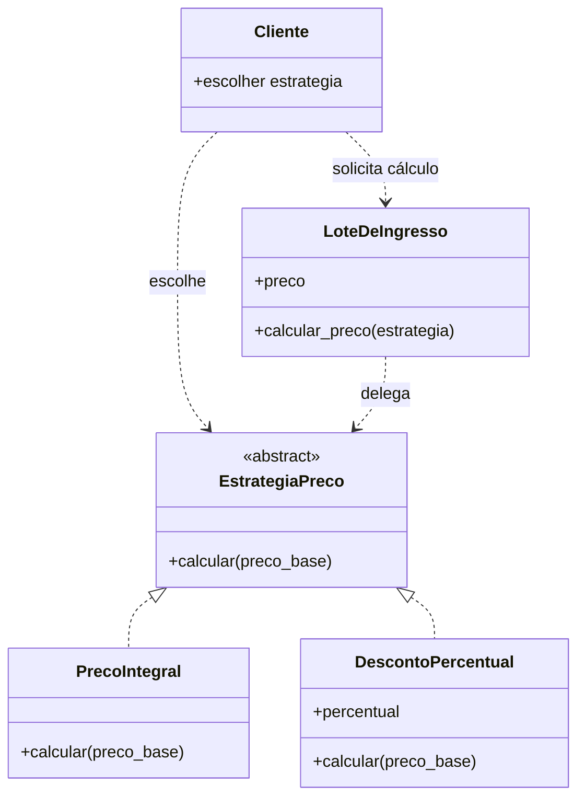
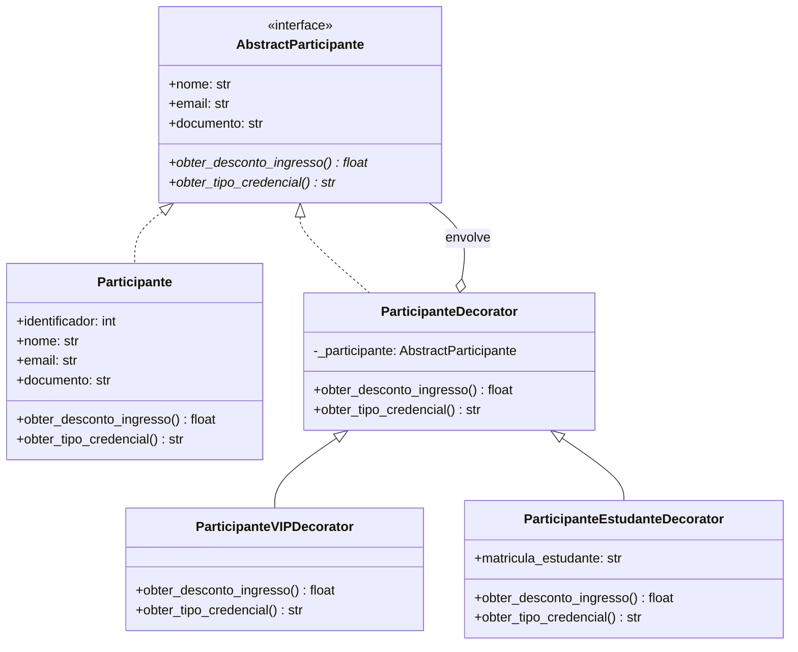
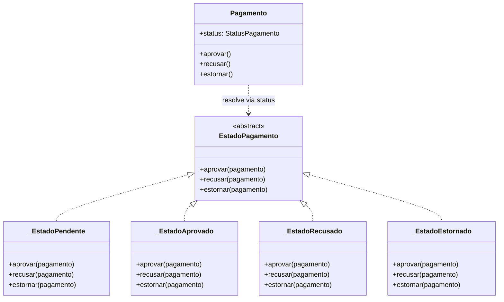

# Padrão GoF: Strategy

- **Categoria:** comportamental.
- **Agregado:** `LoteDeIngresso`.

## Contexto e problema

O lote mantém o preço-base do ingresso (`preco`), mas regras diferentes podem
ser necessárias para calcular o valor cobrado, como preço integral ou desconto
percentual. Concentrar todas essas variações em condicionais de
`LoteDeIngresso` faria a entidade conhecer cada política e exigiria alterá-la
sempre que uma nova regra fosse adicionada.

O método `LoteDeIngresso.calcular_preco` delega o cálculo a uma estratégia
fornecida pelo chamador. `PrecoIntegral` mantém o preço-base, enquanto
`DescontoPercentual` calcula o valor com desconto. O preço persistido continua
sendo o preço-base; a política é selecionada para cada cálculo.

## Por que Strategy

Strategy permite variar o algoritmo sem acoplar o lote às regras concretas e
sem alterar o comportamento existente de criação, venda ou persistência do
lote. Uma alternativa seria colocar uma condição para cada tipo de promoção
dentro de `LoteDeIngresso`; essa opção parece mais simples inicialmente, mas
faz a entidade acumular regras e crescer a cada nova política. State também
foi considerado, mas não se ajusta ao problema: o cálculo depende de uma
política escolhida, não de uma transição do ciclo de vida do lote.

## Participantes

| Papel no padrão | Classe/método no sistema |
|---|---|
| Contexto | `LoteDeIngresso`, que mantém o preço-base e delega em `calcular_preco` |
| Strategy | `EstrategiaPreco`, contrato abstrato com `calcular` |
| Concrete Strategy | `PrecoIntegral`, que retorna o preço-base |
| Concrete Strategy | `DescontoPercentual`, que aplica o percentual validado |
| Cliente | Chamador de `LoteDeIngresso.calcular_preco`, que escolhe a estratégia |

## Diagrama de classes

## Teste

`tests/unit/test_ingresso.py::teste_lote_calcula_preco_com_estrategias_diferentes`
exercita as duas estratégias no mesmo lote: preço integral e desconto de 25%.
`teste_desconto_percentual_invalido` também verifica a validação do intervalo
permitido para o desconto.

## Custo da aplicação

Nesta implementação, o custo inicial foi criar uma
interface (`EstrategiaPreco`), duas implementações (`PrecoIntegral` e
`DescontoPercentual`) e o método de delegação em `LoteDeIngresso`, além dos
testes. Cada nova política de preço exige outra classe de estratégia e testes próprios. 
O chamador também precisa escolher e fornecer a estratégia quando calcula o preço.

Entretanto, há mais arquivos conceituais e indireção do que com um
cálculo simples ou uma condição dentro do lote. Para apenas duas regras
estáveis, essa estrutura pode ser desnecessária; seu benefício aparece quando
as políticas variam ou novas regras são adicionadas com frequência. Nesse caso,
a regra nova fica isolada e não aumenta os condicionais nem altera
`LoteDeIngresso`. As estratégias não precisam ser persistidas, então não há
custo de migração do esquema do banco de dados.

# Padrão GoF: Decorator

- **Categoria:** Estrutural
- **Agregado:** `Inscrição` (`Participante`)
- **Autora:** Gabriela Bitencourt Freire da Silva (@gabibitencourt)

## Contexto e problema

O sistema precisava conceder benefícios e tratamentos diferenciados (como descontos no valor do ingresso e identificação em credenciais/crachás) para categorias especiais de participantes (ex: VIP, Meia-Entrada / Estudante).

Adicionar múltiplos campos booleanos (`is_vip`, `is_estudante`) na classe `Participante` violaria o Princípio da Responsabilidade Única (SRP) e inflaria a entidade. Por outro lado, criar subclasses estáticas para cada combinação possível geraria uma explosão de classes (`ParticipanteVIPEstudante`, `ParticipanteVIP`, etc.).

## Por que Decorator

O padrão **Decorator** permite adicionar responsabilidades e comportamentos adicionais a um objeto individual dinamicamente em tempo de execução, sem afetar outros objetos da mesma classe e sem modificar o código-fonte da entidade `Participante`.

Como alternativa, considerei a Herança Múltipla ou Subclasses Estáticas. No entanto, essa abordagem acoplaria as regras em tempo de compilação e tornaria inviável a combinação dinâmica e flexível de múltiplos privilégios sobre um mesmo participante.

## Participantes

| Papel no padrão | Classe/método no sistema |
|---|---|
| Component (Interface) | `AbstractParticipante`, contrato abstrato com as propriedades e métodos `obter_desconto_ingresso` e `obter_tipo_credencial` |
| Concrete Component | `Participante`, entidade base que retorna o valor integral (0% desconto) e credencial "PADRÃO" |
| Decorator Base | `ParticipanteDecorator`, classe base abstrata que envolve uma instância de `AbstractParticipante` e delega as chamadas |
| Concrete Decorator | `ParticipanteVIPDecorator`, estende a credencial com acesso ao Lounge e garante 20% de desconto |
| Concrete Decorator | `ParticipanteEstudanteDecorator`, valida a matrícula do estudante, estende a credencial e garante 50% de desconto (meia-entrada) |

## Diagrama de classes

## Teste

Os testes unitários em `tests/unit/test_participante.py` exercitam:

`test_gof_decorator_participante_padrao_sem_desconto`: comportamento baseline.

`test_gof_decorator_participante_vip`: benefícios isolados de VIP.

`test_gof_decorator_participante_estudante_meia_entrada`: validação de matrícula e meia-entrada.

`test_gof_decorator_combina_vip_e_estudante`: empilhamento dinâmico de múltiplos decorators sobre a mesma instância.

## Custo da aplicação
O custo principal foi a introdução da interface abstrata `AbstractParticipante`, da classe base `ParticipanteDecorator` e das subclasses de decoradores concretos, além de pequenas indireções no acesso aos atributos.

Em contrapartida, o benefício é a capacidade de combinar privilégios livremente em tempo de execução sem alterar o modelo de dados nem modificar o schema do banco relacional.

# Padrão GoF: State

- **Categoria:** Comportamental
- **Agregado:** `Pagamento`
- **Autor:** Lucas Paixao de Lima Costa (@LucasLimmm2000)

## Contexto e problema

O `Pagamento` tem quatro status (`PENDENTE`, `APROVADO`, `RECUSADO`, `ESTORNADO`) e três transições (`aprovar`, `recusar`, `estornar`), cada uma válida só a partir de alguns status. Antes desta refatoração, os três métodos viviam na própria classe `Pagamento` e cada um checava o status atual com `if`/comparação de enum antes de decidir se a transição era permitida (ver ADR-005, que já documentava essa decisão na Fase 1).

Isso funciona, mas concentra em `Pagamento` o conhecimento de todas as combinações válidas entre status e transição. A cada novo status ou nova transição, os três métodos (ou mais) precisariam ser revisados, e a regra "o que pode acontecer a partir do status X" fica espalhada em vários `if`s em vez de estar num lugar só.

## Por que State

O padrão **State** resolve isso movendo o comportamento de cada transição para uma classe por status: `_EstadoPendente`, `_EstadoAprovado`, `_EstadoRecusado` e `_EstadoEstornado` implementam `aprovar`, `recusar` e `estornar` cada uma à sua maneira — permitindo a transição e trocando o status, ou levantando `OperacaoInvalidaError`. O agregado `Pagamento` não guarda mais a regra: ele resolve o estado atual a partir do `status` persistido e delega a chamada.

Considerei manter as condicionais como estavam (mais simples para só 4 status), mas o GoF State decompõe exatamente esse tipo de máquina de estados finita, e o agregado Pagamento é o que no sistema modela o ciclo de vida mais explícito via enum. Como alternativa, cheguei a pensar num campo de status "livre" (string) com uma tabela de transições, mas isso é o que o próprio ADR-005 já rejeitou — o enum fechado (`StatusPagamento`) continua sendo a fonte da verdade, e o State só organiza o comportamento associado a cada valor dele.

**Decisão de projeto importante:** o `_estado` **não é guardado como atributo no `__init__`** — é uma `@property` que consulta um dicionário `_ESTADOS_POR_STATUS` a partir de `self.status` a cada chamada. Isso é necessário porque o `SqlAlchemyPagamentoRepository` usa mapeamento imperativo (`map_imperatively`): ao recarregar um `Pagamento` do banco, o SQLAlchemy reconstrói o objeto e popula `status` direto, **sem passar pelo `__init__`**. Um `_estado` calculado só na construção ficaria desatualizado nesse cenário (o mesmo cuidado que o Arthur já registrou na refatoração OCP do `Evento`, em `docs/solid.md`).

## Participantes

| Papel no padrão | Classe/método no sistema |
|---|---|
| Contexto | `Pagamento`, que mantém `status` e delega `aprovar`/`recusar`/`estornar` via a property `_estado` |
| State | `EstadoPagamento`, contrato abstrato com `aprovar`, `recusar` e `estornar` |
| Concrete State | `_EstadoPendente` — permite aprovar e recusar; bloqueia estornar |
| Concrete State | `_EstadoAprovado` — permite estornar (se não houve check-in); bloqueia aprovar e recusar |
| Concrete State | `_EstadoRecusado` — bloqueia as três transições |
| Concrete State | `_EstadoEstornado` — bloqueia as três transições |

## Diagrama de classes

## Teste

- `tests/unit/test_pagamento.py` — já existia e continuou passando sem alteração; cobre as transições válidas e inválidas pela interface pública de `Pagamento`, provando que o comportamento não mudou.
- `tests/unit/test_pagamento_estado.py` (novo) — testa o padrão diretamente: `test_pagamento_*_resolve_estado_*` confirma que cada status resolve para a classe de estado correta; `test_estado_e_reavaliado_apos_transicao` prova que o estado não fica em cache depois de uma transição; `test_estado_recusado_nao_permite_aprovar_nem_estornar` cobre um estado "terminal".
- `tests/integration/test_repository_pagamento.py::test_pagamento_recarregado_do_banco_resolve_estado_pelo_status_persistido` (novo) — recarrega um `Pagamento` do SQLite via `session.expire_all()` (contornando a identity map, sem passar pelo `__init__`) e confirma que `_estado` ainda resolve corretamente a partir do `status` persistido.

## Custo da aplicação

- **Custo:** quatro classes de estado concreto além da interface abstrata, mais a property `_estado` que faz o lookup no dicionário `_ESTADOS_POR_STATUS`. Para 4 status e 3 transições, isso é mais código do que os `if`s originais.
- **Por que compensa:** a regra "o que pode acontecer a partir do status X" fica inteira em uma única classe, em vez de espalhada nos três métodos de `Pagamento`. Adicionar um novo status no futuro significa criar uma nova classe de estado, sem editar as transições dos estados existentes. A interface pública de `Pagamento` (`aprovar`/`recusar`/`estornar`/`status`) não mudou, então `services.py`, `flask_app.py` e todos os testes existentes continuaram funcionando sem alteração — só o `tests/unit/test_pagamento_estado.py` e o novo teste de integração foram acrescentados.
